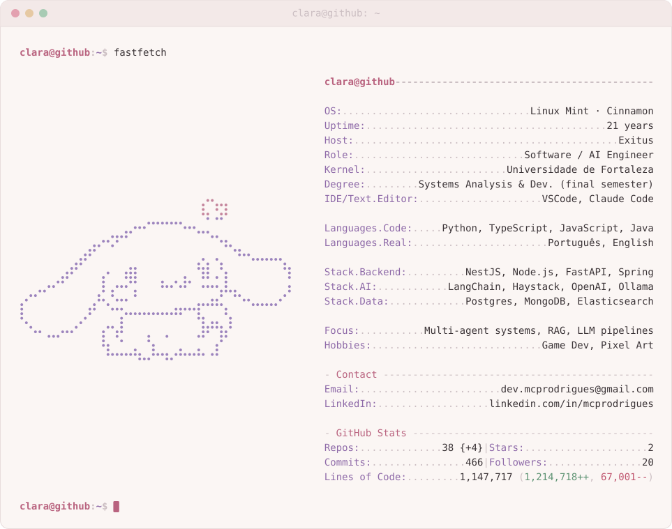

  <a href="https://github.com/mcprodrigues">
    <picture>
      <source media="(prefers-color-scheme: dark)" srcset="terminal/dark.svg">
      
    </picture>
  </a>

 

### ♡ hi, i'm clara

I'm a **Software / AI Engineer** at **Exitus** and a final-semester **Systems Analysis & Development** student at **UNIFOR**. I love building backend systems that power intelligent applications — designing clean APIs, data pipelines and LLM workflows, and understanding how small architectural decisions shape scalability and performance. Off the clock, I make little games and pixel art.

 

### ✦ what i do

- 🌷 **Software / AI Engineer** @ Exitus — building backend services and AI-driven features, from API design to production.
- 🎓 **Systems Analysis & Development** @ [UNIFOR](https://unifor.br/) — final semester.
- 🤖 **Agent orchestration** — exploring multi-agent systems, RAG architectures and LLM orchestration patterns with modern Python frameworks.

 

### ✦ tech stack

**languages** 

**backend & apis** 

**frontend** 

**ai & machine learning** 

**vector databases** 

**rag architectures** 

**databases** 

**devops & tools** 

**ai dev tools** 

 

### ✦ current focus

- 🧠 **multi-agent systems** — architecting agent orchestration patterns
- 🕸️ **graphrag** — knowledge-graph-enhanced retrieval for complex reasoning
- 🔗 **rag pipelines** — retrieval-augmented generation with haystack and langchain
- 🛠️ **mcp** — production-ready patterns with the model context protocol
- ⚡ **prompt engineering** — effective llm interactions for complex workflows

 

### ✦ off the clock

🎮 game dev &nbsp;·&nbsp; 🎨 pixel art &nbsp;·&nbsp; 💭 psychology

 

### ✦ let's connect

 

  <i>always learning, always building ♡</i>

